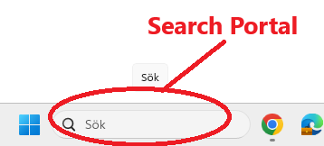
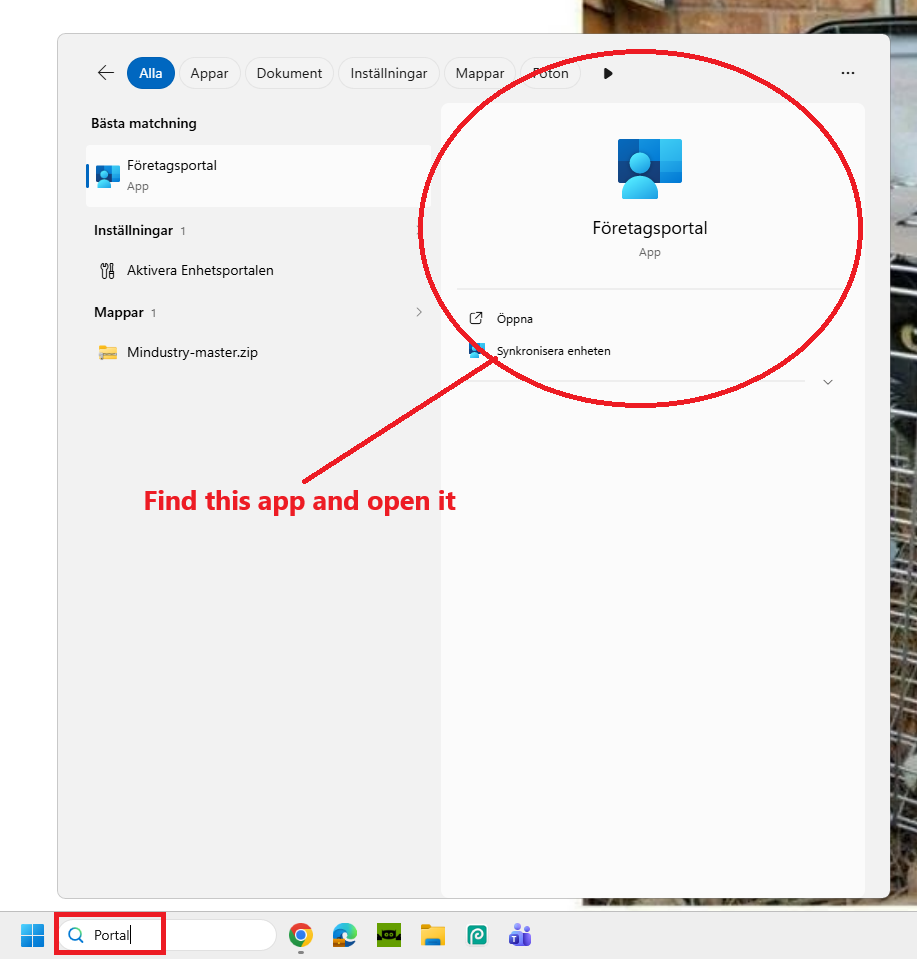
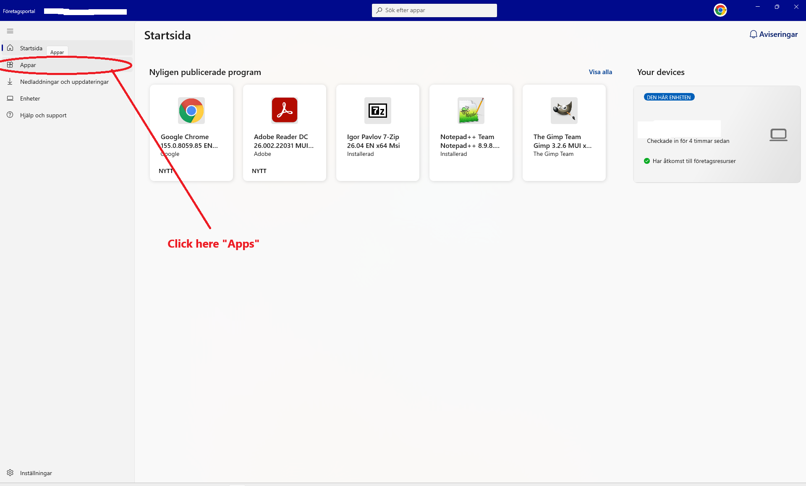
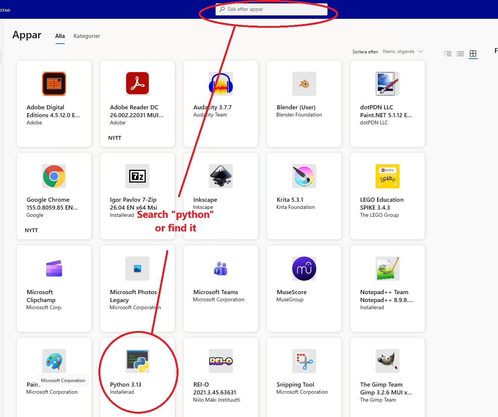
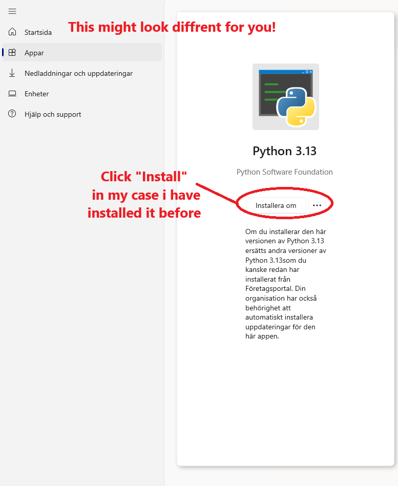
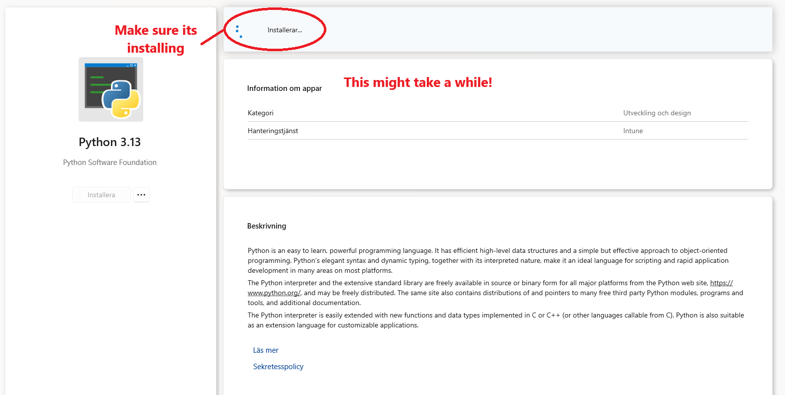
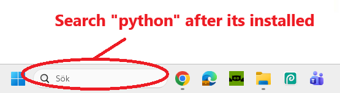
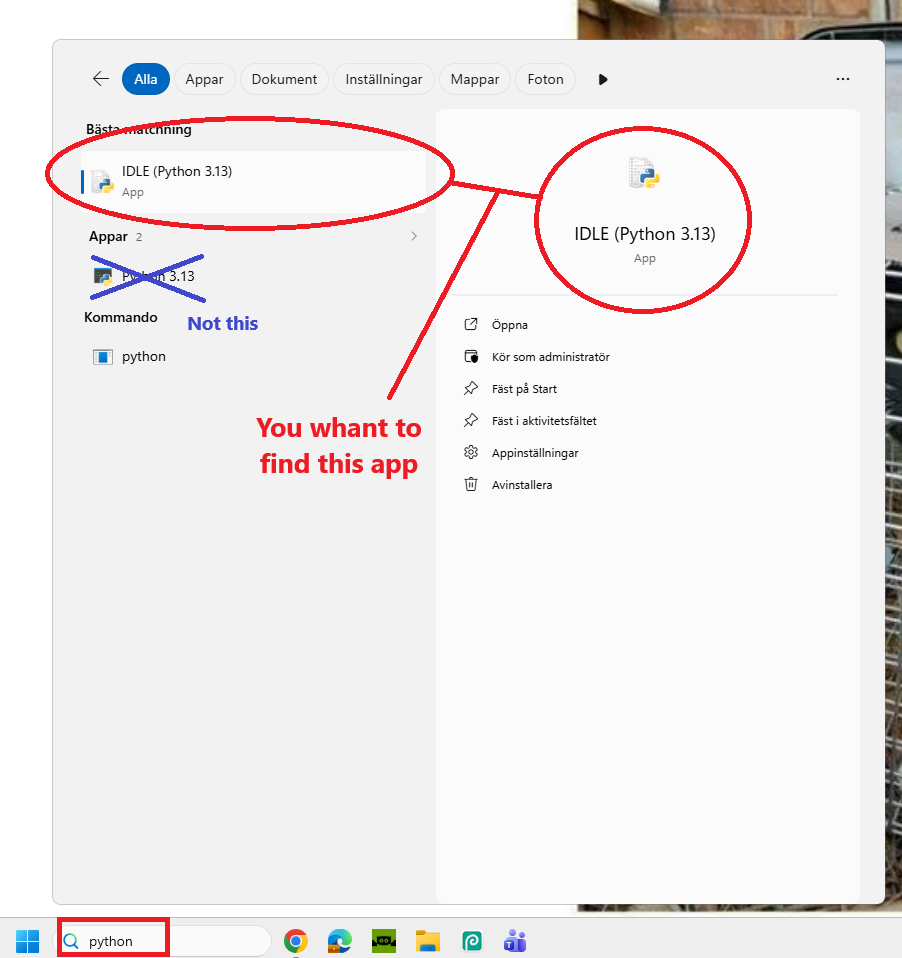

# Desktop-Drift
I started making this in school when i realized that "oh right we have python!" 
It started making it with Google Ai. Later on when i came home i deiced to work more.
Since i use DDG at home i usedDuckDuckGo Ai make the rest of the game.
the sprites i made except for the car which i found on Itch.io

Reason i used ai is i cant code and i would love to but i made this just for entertaning
Otherwise i would have done it myself but oh well, at least i made the sprites right?

### What is this?
Well its a little game inspired by desktop goose, ie you drive on your screen.
But! made so that you can play it even when .exe files are blocked or your school chromebook

## To run from source you need
- Windows
- Python 3
- The libraries listed in `Car Game/requirements.txt`
- The asset files included in `Car Game/Assets/`

## Controlls

Driving
- Arrw Up 
(Car drives in the direction its pointing)
- Arrw Down 
(Car reverses or brakes if your moving forward)
- Arrw Left/Right
(Turns the car to the left or right)
- 1
   (Places a traffic cone at your mouse pointer the car can collide with)
- 2
(Places a yellow dot at your mouse loaction press 2 again at a diffrent loaction to place a wall)

## How to Install and Run

The easiest way to play is to download `Desktop-Drift.exe` from the [latest release](https://github.com/FinnishSwedRetard/Desktop-Drift/releases/latest) and double-click it. The game and its requirements are included, so you do not need to install Python or anything else.

If your computer blocks `.exe` files, or you want to run the game from source, install Python 3 and run these commands from the repository folder:

```powershell
python -m pip install -r "Car Game/requirements.txt"
python "Car Game/desktop_drift.py"
```

School computers may have different restrictions or Python installations, so it might be a bit tricky if you aren't that tech-savvy. If that is the case, ask someone in your class who is to help.

### Heres a Step by Step guide to install python if you can install it from https://www.python.org/downloads/


#

#

#

#

#

#

#

# nice now you have python! almost done
now that you have python lets download the game
## Download and Run the Game

### 1. Download the game

1. Go to this project's GitHub page.
2. Click the green **Code** button.
3. Click **Download ZIP**.
4. Open your **Downloads** folder.
5. Right-click the downloaded ZIP file and select **Extract All...**.
6. Open the extracted game folder. It should contain `desktop_drift.py`, `requirements.txt`, and the `Assets` folder.


### 2. Install the required packages

1. Open the extracted game folder in File Explorer.
2. Click the address bar at the top of the window.
3. Type `powershell` and press **Enter**.
4. In the PowerShell window, type this command and press **Enter**:

   ```powershell
   py -m pip install -r requirements.txt
   ```

This installs the libraries the game needs. Wait for the command to finish before moving on.

If PowerShell says that `py` is not recognized, try:

```powershell
python -m pip install -r requirements.txt
```

If package installation is blocked or asks for permission you do not have, ask your school's IT staff for help. Do not try to bypass school restrictions.


### 3. Start the game

In the same PowerShell window, type:

```powershell
py desktop_drift.py
```

If that does not work, try:

```powershell
python desktop_drift.py
```

Keep the `Assets` folder next to `desktop_drift.py`. The game needs it to load the car, cone, and wall images.

### Troubleshooting

If the game shows an error, take a screenshot of the error message and ask someone who can help with Python. On a school computer, some installations or programs may be blocked by school policy.
or ask microsoft copilot to help you i cant be bother explaining all of this cuz its ALOT of trubleshooting so your own your own i migth figur out somthing beter in the future


Hears the car sprite i used
https://vinchy007.itch.io/3d-pixelart-cars
